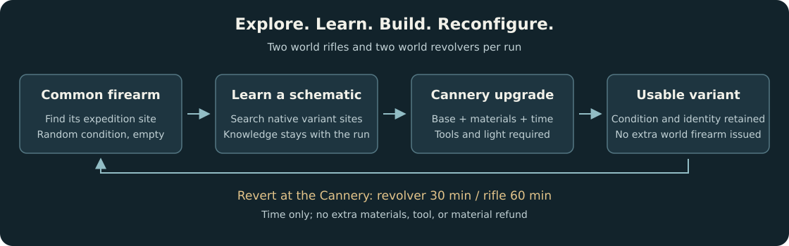

# Interloper Overhaul

**Restore the missing content. Make exploration matter. Keep equipment scarce.**

A personal **The Long Dark** mod by **Spelunkern**, built around standard
**Interloper**. Explore restored buildings, caches, and rewards; search remote
locations for scarce equipment; and use the Cannery to turn limited base weapons
into learned variants. The mod also adjusts equipment, food, skills, afflictions,
shelters, and roadside supplies.

The documentation describes the **current implementation**. Release history lives
in the [changelog](CHANGELOG.md).

## Explore the features

| System | What changes | Details |
| --- | --- | --- |
| World and progression | Intact Coastal Highway houses, normal bunker distribution, restored containers, HRV and Tales rewards, region selection, three feats | [World restoration](docs/features.md#world-restoration-and-new-games) |
| Exploration and rarity | Restored premium equipment is restricted to difficult destinations; generic locations and beachcombing stay sparse | [Loot rules](docs/features.md#exploration-and-loot-rarity) |
| Finite equipment | Two world rifles, revolvers, hunting knives, and hatchets; two standard flashlights and one Miner's Flashlight per new run | [Finite equipment](docs/features.md#finite-world-equipment) |
| Variants | Find schematics at native variant sites, upgrade base items at the Cannery, and revert firearms for time only | [Variants and recipes](docs/features.md#variant-schematics-and-conversions) |
| Manufacturing | Eight Cannery recipes, flare recycling, efficient arrow shafts, and milling restoration | [Manufacturing](docs/features.md#cannery-manufacturing-and-milling) |
| Equipment and accessories | Lighter gear, warmer lanterns, repairable vest, permanent Tool Belt and Rifle Holster bonuses | [Equipment](docs/features.md#equipment-and-permanent-upgrades) |
| Clothing and nutrition | Revised protection, warmth, movement penalties, food weights/calories, and drink effects | [Clothing and food](docs/features.md#clothing-food-and-drinks) |
| Fire and skills | Useful tinder at high skill, improved fuel, stronger feats, Cooking/Mending 5 at 250 points | [Fire and skills](docs/features.md#fire-skills-and-feats) |
| Afflictions and wildlife | Temporary but dangerous frostbite, shorter parasite treatment, no cabin fever, weaker cougars, stronger defensive prybar | [Afflictions and combat](docs/features.md#afflictions-and-wildlife) |
| Shelter and supplies | Warmer shelters/cars, occasional fuel tanks, paper in mailboxes, cheaper rock caches, revised noisemakers | [Shelters and supplies](docs/features.md#shelters-roadside-supplies-and-explosives) |



**Scope:** gameplay changes target standard Interloper. Pilgrim, Voyageur, Stalker,
Misery, Custom, challenges, and Wintermute keep their own balance. Fast startup is global.

## Install and play

Verified on **The Long Dark 2.55**, native **Linux x64**, **MelonLoader 0.7.3**.
The repository includes setup, build, deployment, and launch scripts. A licensed
Steam installation is required; game content and generated assemblies are not
included.

```bash
git clone https://github.com/Spelunkern/interloper-overhaul.git
cd interloper-overhaul
./scripts/setup.sh
./scripts/launch.sh  # First setup only: generate references, then close the game.
./scripts/deploy.sh
./scripts/launch.sh
```

See [installation and troubleshooting](docs/installation.md) for requirements,
Steam launch options, paths, and removal. Close the game before setup or deployment.

**Start a new Interloper game for the full world distribution and finite-item
counts.** Existing saves keep searched containers and saved equipment. Known allocation
plans migrate to add a second firearm/tool of each eligible type. Most item/skill/affliction changes also apply to existing saves; see
[save compatibility](docs/compatibility.md).

## Testing the mod

Current automated baseline: **1,100 native runtime checks** and **3,319 policy
checks**. These exercise native hooks and isolated fixtures at the main menu;
full survival traversal, combat, and crafting interruptions still need playtesting. See [development and validation](docs/development.md) for commands,
coverage, limitations, and a focused manual checklist.

## Documentation and references

- [Complete feature and balance reference](docs/features.md)
- [Installation and troubleshooting](docs/installation.md)
- [Existing saves and compatibility](docs/compatibility.md)
- [Development, validation, and issue reports](docs/development.md)
- [Illustrations and wiki references](docs/media.md)
- [Release history](CHANGELOG.md)
- [Third-party notices](THIRD_PARTY_NOTICES.md)

Independent community project, not affiliated with Hinterland. DLC ownership,
mission progress, locks, and native access requirements still apply.
