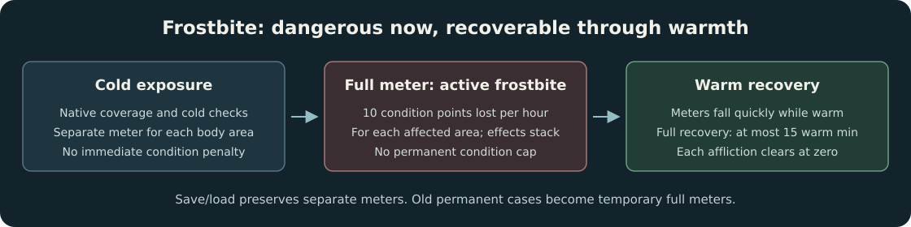

# Feature and balance reference

[Overview](../README.md) · [Install](installation.md) · [Save compatibility](compatibility.md)
· [Debug tools](debug-tools.md)

This is the current behavior of Interloper Overhaul, checked against the local
**2.55** installation and the policies in this repository. Values below apply to
**standard Interloper** unless stated otherwise. Unlisted properties retain their
native behavior. Release numbers and retired rules belong in the
[changelog](../CHANGELOG.md).

- [World restoration and new games](#world-restoration-and-new-games)
- [Exploration and loot rarity](#exploration-and-loot-rarity)
- [Finite world equipment](#finite-world-equipment)
- [Variant schematics and conversions](#variant-schematics-and-conversions)
- [Cannery manufacturing and milling](#cannery-manufacturing-and-milling)
- [Equipment and permanent upgrades](#equipment-and-permanent-upgrades)
- [Clothing, food, and drinks](#clothing-food-and-drinks)
- [Fire, skills, and feats](#fire-skills-and-feats)
- [Afflictions and wildlife](#afflictions-and-wildlife)
- [Shelters, roadside supplies, and explosives](#shelters-roadside-supplies-and-explosives)

## World restoration and new games

| Area | Current behavior |
| --- | --- |
| Coastal Highway | Intact houses in all five randomized building groups; the Interloper-only burnt-house group is disabled; two independently hidden houses and their interior access are restored |
| Prepper caches | New worlds use the normal three furnished/six abandoned interior distribution; native location selection remains |
| Timberwolf Mountain | Normal cargo assemblies and summit cargo return; hacksaw requirements and locks remain |
| Hushed River Valley | The Mysterious Signal Fire Moose-Hide Satchel returns; the native choice between its two locations remains |
| Mementos | Missing notes, keys, and cache objects return; cache rewards use the supply-based rules below |
| Tales | Unique rewards and normal radio-cache/crash-box alternatives return; Alpha/Beta/Gamma/Omega interiors and radio-cache containers use normal restored generation followed by the relevant scarcity rules |
| Sutherland | Story rewards and unlocked exchanges return; trust, delivery requirements, prices, and progression remain |
| Starting region | Choose from the normal Stalker region choices or use random selection; outdoor starts remain |
| Feats | Select up to three already unlocked feats when starting a run |

Difficulty exclusions are removed from eligible Survival objects, parent groups,
gear prefabs, loot filtering, and Trader eligibility before the mod's specific
rarity and allocation rules apply. This restores opportunities, rather than
forcing every object to appear. Entirely disabled random object groups recover
their authored Medium-resource count; existing positive Interloper counts do not
increase. Wildlife/survivor groups, weather, general empty-container rates, and
ordinary container quantities retain their native rules.

Reduced radio-cache and mountain-cargo alternatives stay disabled alongside their
normal replacements to avoid duplicates. Wintermute/challenge-only content is not
imported. DLC ownership, mission progression, locks, keys, and research-set
selection still control access.

**Fast startup applies globally:** boot logos, initial disclaimers, the initial
keypress gate, and the menu introduction movie are skipped. Profile loading and
error handling still run; in-game cinematics retain normal playback.

Sources: [world policy](../shared/WorldPolicy.cs),
[house restoration](../src/InterloperOverhaul/CoastalHouses.cs),
[bunkers](../src/InterloperOverhaul/BunkerPatches.cs),
[Tales rewards](../src/InterloperOverhaul/TaleRewards.cs),
[new-game options](../src/InterloperOverhaul/NewGameOptions.cs).

## Exploration and loot rarity

### Restored opportunities

| Newly restored source | Premium clothing | Other restored clothing/tools | Ordinary restored supplies |
| --- | --- | --- | --- |
| Ordinary buildings, vehicles, containers | Excluded | Excluded | 5% retained |
| Beachcombing, including large-find contents | Excluded | Excluded | 5% retained |
| Remote destinations, ordinary memento/radio caches | Excluded | 1% retained | 5% retained |
| Verified deep destinations, Tales bunkers | 1% retained | 5% retained | 5% retained |

A retention rate is an **additional roll after native selection**, not a chance
per container. For example, 1% retention keeps roughly one out of one hundred
eligible restored opportunities before accounting for how often the game selects
that item. Rejected opportunities remain empty; no replacement roll is granted.

This filter targets newly restored sources. An original Interloper world hammer
or native beach find keeps its original eligibility even if that item also occurs
in a restored source. Finite equipment, ammunition, casings, ingredients, schematics,
and authenticated progression rewards have the separate rules described here.

Selections are deterministic from the run seed, source, item, and opportunity;
they do not consume the shared random stream. Actual container geography determines
the source class. Beach sources take precedence over their surrounding region.
Searched containers, saved finds, and owned/stored equipment are preserved.

### What counts as deep exploration?

Deep access is limited to these audited destinations, not entire outdoor regions:

- Timberwolf Mountain summit tail and summit cave.
- Ash Canyon gold-mine interior.
- Hushed River Valley's two Signal Fire destinations and Lake Cave site.
- The authored HRV1 lockbox and HRV2 rock cache.
- The Concentrator watchroom branch and Tales bunker interiors.

Remote access includes ordinary memento/radio caches, the Coastal Highway lookout
destination, and the old Mystery Lake lookout. Outdoor destinations use bounded
three-dimensional areas; the rest of their regions remains ordinary.

Premium clothing includes the balaclava, expedition/military/down parkas, leather
flight jacket, insulated/combat pants, climbing socks, wool long underwear,
gauntlets, mukluks, insulated/ski boots, and the higher-tier wool sweaters and coats
listed in [ExplorationPolicy](../shared/ExplorationPolicy.cs). Their restored
opportunities are deep-only. The same policy lists utility tools; unrelated native
Interloper sources are preserved.

### Beachcombing

The restoration includes difficulty-excluded contents inside washed-up boats and
large finds, including canoe arrows and the broken arrow. Only known beachcombing
hierarchies receive the exception; objects disabled in all three ordinary Survival
difficulties stay disabled.

Normal/post-blizzard tables keep their native entries, weights, compatible-location
requirements, locks, quantity settings, expiry, and selection rules. Spawn timing,
blizzard frequency, and weak-ice hazards are unchanged. The scarcity rules above
still apply to restored contents. Finite firearms/tools/flashlights and usable
variants cannot be obtained as new beach finds. Rejected loose finds consume their
native opportunity and keep its respawn timer. Saved finds are not reset.

### Memento and progression rewards

Memento reward slots use stable per-run/cache selections instead of guaranteed
premium gear. The ordinary pool contains energy bars, beef jerky, dog food,
peaches, tomato soup, condensed milk, cured leather, cloth, scrap, sewing kits,
whetstones, bandages, antiseptic, purification tablets, matches, fishing tackle,
stump remover, and dusting sulfur.

Remote/deep selections favor expedition supplies: cured leather, scrap, sewing
kits, whetstones, bandages, matches, and the two ammunition chemicals. Only the
**first slot of a deep memento** can select rare equipment, at **1%**: a
firestriker, quality tools, gauntlets, or wool long underwear. Other slots and
ordinary/remote mementos cannot roll this pool. No firearm, usable variant, or
finished ammunition is introduced through this replacement pool.

| Memento slot | Ordinary supply pool | Expedition pool | Rare-equipment pool |
| --- | --- | --- | --- |
| Ordinary cache, any slot | 100% | 0% | 0% |
| Remote cache, any slot | 30% | 70% | 0% |
| Deep cache, first slot | 30% | 69% | 1% |
| Deep cache, later slots | 30% | 70% | 0% |

These are selections between replacement pools. Items shared by two pools can
have more than one selection path; the rare pool is not an extra roll per slot.

Unique Tales rewards and the HRV Signal Fire satchel keep their progression rules.
A Tales rarity exemption requires both an actual Tales bunker scene and its native
Design hierarchy; an item name alone does not grant an exemption. Variant rewards
follow schematic conversion instead of granting usable variants.

### Ammunition and ammunition ingredients

| Source/item | Current rule |
| --- | --- |
| Found rifle/revolver ammunition | 0.25% retention after native selection |
| Found empty rifle/revolver casings | 0.5% retention after native selection |
| Casings recovered by firing | Preserved |
| Player-crafted ammunition | Preserved |
| Trader ammunition/casing offers | Same retention rates, stable for the run/item/native aurora number |
| Authored stump-remover/dusting-sulfur world placements | Base spawn-chance floors of 25% ordinary/beach, 50% remote, 75% deep; higher native chances remain |

The two chemicals bypass the ordinary 5% restored-loot filter and can appear in
memento supplies. A spawn-chance floor does not force an item into every location:
native difficulty scaling and location/group selection still apply. Other
ammunition types, such as flare shells, retain their own rules.

Trader checks do not change prices, exchange assets, progression, or existing
active trades. Reopening the radio or reloading does not reroll the same aurora.

Sources: [exploration](../shared/ExplorationPolicy.cs),
[loot filtering](../src/InterloperOverhaul/LootBalance.cs),
[mementos](../shared/MementoRewardPolicy.cs),
[Trader supplies](../src/InterloperOverhaul/TraderFirearmSupplies.cs).

## Finite world equipment

| Item | New-run world allocation | Initial state |
| --- | --- | --- |
| Standard rifle | 1 | 1–100% condition; no ammunition or spent casings |
| Standard revolver | 1 | 1–100% condition; no ammunition or spent casings |
| Hunting knife | 1 | 1–100% condition |
| Standard hatchet | 1 | 1–100% condition |
| Standard flashlight | 2, at distinct selected sites | 1–100% condition |
| Miner's Flashlight | 1, at the native Concentrator watchroom placement | 1–100% condition |

The rifle, revolver, knife, and hatchet occupy **four different destinations**
selected from five: summit cave, Ash Canyon gold mine, HRV Lake Cave, and the two
HRV Signal Fire destinations. Exploration order does not choose the allocation.

Standard flashlights select two verified placements from Ash Canyon, the Forlorn
Muskeg plane crash, HRV Lake Cave, summit cave, and the Broken Railroad ravine site.
Native flashlight aurora/battery behavior remains.

Sites, condition decisions, native identities, and creation flags are saved with
the run. Equipment materializes when its scene loads. Revisits, saving/loading,
loss, harvesting, or destruction do not grant replacements. Fresh generic loot,
scripted/random containers, caches, beachcombing, and Trader offers cannot issue
additional copies of these finite items.

**The knife/hatchet limit is a world-allocation limit.** Paid manufacturing can
produce further standard tools; it does not consume or reroll that allocation.
Firearm variants consume the existing base weapon and can be reverted, allowing
one world firearm to support different upgrades over time.

Existing saves retain their original allocation plan and serialized equipment,
including legacy locations. They are not retroactively reduced to these counts or
granted a new expedition allocation. See [save compatibility](compatibility.md).

Sources: [equipment destinations](../shared/FirearmSpawnPolicy.cs),
[flashlight destinations](../shared/LightSpawnPolicy.cs),
[run allocation](../src/InterloperOverhaul/FiniteFirearms.cs).

## Variant schematics and conversions

In standard Interloper, authored variant weapon placements now yield physical
**Workshop Schematics** instead of usable weapons. Their native location selection
and spawn rolls still apply; the additional restored-loot rarity roll does not.
Selected Tales/cache variant rewards become schematics, and variant Trader offers
retain their native costs and progression. Random ordinary loot and beachcombing
cannot supply variant weapons. Previously serialized or owned variants are preserved.

Schematics use an existing blueprint-card model with a variant-specific English
name and description. Picking one up records it permanently for that run, appends
its description to journal notes, unlocks its recipe, and removes the card from the
inventory. All eleven variants are included, including the Bushcraft Bow.

Upgrades require the **Bleak Inlet Cannery ammunition workbench**, light, the
learned schematic, and one usable base item. Quality tools are required for firearm
and Survival Knife upgrades; bows require a standard, improvised, or Survival Knife.
Tools are reusable and use native crafting wear. There is no additional skill gate.

| Result | Base item | Additional consumed materials | Base time |
| --- | --- | --- | --- |
| Survival Knife | Hunting knife | 3 scrap metal, 1 cured leather, 1 cloth | 180 min |
| Forester's Revolver | Revolver | 3 scrap metal, 1 cured maple, 1 cured leather | 240 min |
| Warden's Revolver | Revolver | 2 scrap metal, 1 cured leather | 180 min |
| Hunter's Revolver | Revolver | 4 scrap metal, 2 cured leather | 300 min |
| Vaughn's Rifle | Rifle | 3 scrap metal, 1 cured leather | 300 min |
| Barb's Rifle | Rifle | 6 scrap metal, 1 cured maple, 2 cured leather | 420 min |
| Curator's Rifle | Rifle | 5 scrap metal, 1 cured maple, 1 cloth | 480 min |
| Ranger's Rifle | Rifle | 4 scrap metal, 1 cured maple, 2 cured leather | 420 min |
| Woodwright's Bow | Survival bow | 1 cured maple, 2 cured guts, 1 cured leather | 300 min |
| Sport Bow | Survival bow | 2 scrap metal, 1 cured maple, 2 cured guts | 360 min |
| Bushcraft Bow | Survival bow | 1 cured birch, 2 cured guts, 1 cloth | 240 min |

Once a firearm-family schematic is known, any variant in that family can be
returned to its common version at the Cannery: **30 minutes for a revolver or
60 minutes for a rifle**, with no materials or tool required and no material refund.
Upgrading and reverting preserve normalized condition and the original weapon's
native identity. Ruined weapons, loaded firearms, and firearms containing spent
casings cannot start a conversion. The base is reserved as one native work item;
interrupted work retains its recipe, condition, and progress through saves. A failed
start returns the original item. Conversions never issue an additional world weapon.

Sources: [all variant recipes](../shared/VariantPolicy.cs),
[schematic handling](../src/InterloperOverhaul/Workshop.cs),
[conversion persistence](../src/InterloperOverhaul/WorkshopConversions.cs).

## Cannery manufacturing and milling

Standard Interloper gains eight native crafting recipes at the **Cannery ammunition workbench**.
They use the existing crafting UI, light/tool requirements, material consumption,
work in progress, and native gear saves. No ModComponent, settings menu, external
blueprint files, or custom item bundles are required.

| Recipe | Consumed materials | Reusable tool | Output | Base time |
| --- | --- | --- | --- | --- |
| Refine a hunting knife | 1 improvised knife, 4 scrap metal, 1 cured leather | Quality tools | 1 hunting knife | 240 min |
| Refine a hatchet | 1 improvised hatchet, 6 scrap metal, 2 cured leather | Quality tools | 1 standard hatchet | 360 min |
| Efficient arrow shafts | 1 cured birch sapling | Standard/improvised knife or hatchet | 4 arrow shafts | 60 min |
| Red-flare shell | 2 unused red flares, 1 scrap metal, 1 cloth | Standard/improvised knife | 1 flare shell | 90 min |
| Blue-flare shell | 2 unused marine flares, 1 scrap metal, 1 cloth | Standard/improvised knife | 1 flare shell | 90 min |
| Gunpowder shell | 100 g gunpowder, 1 scrap metal, 1 cloth | None | 1 flare shell | 90 min |
| Recycle red flares | 3 unused red flares | Standard/improvised knife | 100 g gunpowder | 90 min |
| Recycle marine flares | 3 unused marine flares | Standard/improvised knife | 100 g gunpowder | 90 min |

Arrow-shaft production requires a knife or hatchet (standard or improvised).
Flare conversions require a standard or improvised knife. Burning, exhausted, wet,
and previously extinguished flares do not count as unused inputs. Recycling creates
a partially filled native gunpowder can, rather than a free full can. Shell recipes
consume casing/wadding materials; they do not add rifle/revolver ammunition or casings.

**The one-knife/one-hatchet rule limits world allocation.** Paid manufacturing
upgrades are repeatable and do not consume or reroll those world allocations.
Manufactured gear is treated as player-owned, so the rarity and spawn-cap filters
cannot delete it. Additional tools still cannot spawn through beachcombing or Trader
stock. Variant upgrades follow the schematic system in the preceding section.

Native **milling machines** can repair and restore the distress pistol and standard
crampons. Repairs require 1 scrap metal and 30 base minutes; full restoration from
ruined requires 3 scrap/180 minutes for the pistol or 4 scrap/210 minutes for crampons.
Aurora/power, access, native repair skill behavior, and machine availability remain
under the game's control. Interrupted restoration progress uses the native gear save.

This is a new implementation inspired by
[Cannery Manufacturing](https://github.com/ds5678/CanneryManufacturing) and its
[DLC update](https://github.com/DigitalzombieTLD/CanneryManufacturingDLC), with revised
recipes and explicit integration with this mod's loot rules. It does not import their
settings, firearm condition overrides, extra reloading crates, or cannery-code bypass.
See [third-party notices](../THIRD_PARTY_NOTICES.md).

Sources: [manufacturing recipes](../shared/ManufacturingPolicy.cs),
[crafting integration](../src/InterloperOverhaul/Manufacturing.cs),
[milling](../src/InterloperOverhaul/ManufacturingMilling.cs).

## Equipment and permanent upgrades

### Item weights and lantern heat

These weights apply to existing and newly created Interloper gear. Weights for
empty vessels exclude their contents; stack weights are per item.

| Item | Weight |
| --- | --- |
| Can opener | 0.10 kg |
| Insulated flasks, all seven styles (empty) | 0.10 kg |
| Recycled can (empty) | 0.10 kg |
| Improvised hatchet | 1.50 kg |
| Improvised knife | 0.50 kg |
| Stones | 0.10 kg each |
| Standard arrows | 0.10 kg each |
| Red and marine flares | 0.20 kg each |
| Car battery | 5.00 kg |
| Replacement fuse | 0.10 kg |
| Ordinary and research books, including open book models | 0.20 kg each |
| Snare | 0.20 kg |
| Mountaineering rope | 2.50 kg |
| Woodworking tools | 1.00 kg |
| Spray paint, both can models | 0.20 kg total |
| Water purification tablets | 0.10 kg per native unit |
| Stump remover | 0.20 kg |
| Noisemaker | 0.10 kg |

Standard and Spelunker's lanterns provide **+6°C** through their native heat source.
Fuel consumption, light, heat radius, and ignition behavior retain their normal rules.
Insulated flasks no longer lose condition with time; their existing condition and
fall damage remain intact. Their drinks still cool normally and contribute their
native weight. Recycled cans also retain the weight of their contents. Spray paint
has a fixed 0.20 kg total weight, without replenishing paint or changing its uses.
Stack sizes, research progress, crafting recipes, and loot availability are unaffected.

### Ballistic Vest and permanent accessories

In standard Interloper, the **Ballistic Vest** weighs **2 kg**, provides **20% maximum
protection**, and reduces the sprint bar by **10%**. Its portable native repair action
requires **one cured leather**, takes **30 base minutes**, and restores **10 percentage
points** of condition, capped at 100%. No tool or workshop is required, and this repair
has a guaranteed success chance. Existing wear is preserved; repairs do not turn the
vest into a new item. The moose-hide satchel and wool ear wrap each weigh **0.10 kg**.
The satchel retains its normal equipment slot and carrying-capacity behavior.

The **Foreman's Tool Belt** and **Rifle Holster** become permanent, run-specific
collectible upgrades. Picking either up unlocks its bonus and removes the physical
item. Neither occupies an accessory slot, adds carried weight, needs to be worn,
or imposes a clothing penalty. Duplicate pickups do not stack. The world models,
reward locations, costs, and progression still apply. English pickup notifications,
item descriptions, and journal notes explain the permanent unlocks.

- **Tool Belt:** reduces the weight of the heaviest carried item of each tool type by
  **50%**, with no three-type limit. Weapons and ammunition are excluded. Tools use the
  game's Tool category; knife, hatchet, toolkit, lantern, flashlight, and spray-paint
  variants share their functional type. A stack contributes only one item's weight.
- **Rifle Holster:** reduces the weight of **one heaviest carried rifle by 50%**, across
  common rifles and all rifle variants, including Ranger's Rifle. It does not reduce
  revolver or bow weight. The belt provides no additional weapon discount.

Selection follows the current inventory and actual item weight, so dropping or
storing the heaviest eligible item immediately changes the selected item. The bonuses
apply to carried weight without changing the physical weight of dropped or stored
gear. Native wearable belt/holster reductions are suppressed to prevent double counting.

Unlock flags are stored inside the native save slot and reset for a new run. Existing
carried or equipped belts and holsters are converted into unlocks after loading; an
already worn item is removed from its slot. No new run is required for these changes.

Sources: [item weights](../shared/ItemBalancePolicy.cs),
[vest](../src/InterloperOverhaul/ArmorBalance.cs),
[accessory rules](../shared/PermanentAccessoryPolicy.cs).

## Clothing, food, and drinks

The following changes apply to standard Interloper, including existing gear.
Clothing values are at full condition; protection and sprint penalties use percent.

| Clothing | Weight | Other changes |
| --- | --- | --- |
| Rabbitskin hat | 0.25 kg | |
| Hardhat | 0.50 kg | 10% protection |
| Cotton scarf | Unchanged | +1°C wind protection |
| Bearskin coat | 4.00 kg | 5°C warmth, 15% sprint penalty |
| Moose-hide cloak | 3.50 kg | 4°C warmth, 25% protection |
| Wolfskin coat | 2.50 kg | 10% protection, 5% sprint penalty |
| Wolfskin pants | 2.00 kg | |
| Deerskin pants | 1.50 kg | |
| Improvised crampons | 1.00 kg | No protection, 10% sprint penalty; climbing benefits retained |

| Food or ingredient | Full weight | Full calories, where changed |
| --- | --- | --- |
| Condensed milk, dog food | 0.20 kg each | |
| Peaches | 0.25 kg | |
| Tomato soup | Unchanged | 600 |
| Sodas, including the energy drink | 0.20 kg each | |
| Canned corn | 0.25 kg | |
| Canned ham | Unchanged | 1,500 |
| Canned pineapple | 0.25 kg | 600 |
| Cereal | Unchanged | 1,000 |
| Dried apples | Unchanged | 600 |
| Pickles | 0.50 kg | 800 |
| Cooking oil | 0.50 kg | |
| Flour | 1.00 kg | |
| Potatoes, raw and cooked | 0.10 kg each | |
| Oats | 0.75 kg | |
| Salt | 0.10 kg | |
| Salt bag | 3.00 kg | |

Oil, flour, oats, and salt retain their native recipe quantities and container
capacities. Their carried mass scales with the remaining contents. Existing food
retains its consumed proportion and cooking calorie bonus when migrated; repeated
save/load cycles do not multiply calories or refill empty food.

Acorn coffee matches normal coffee: 10% immediate fatigue recovery, 50% fatigue
accumulation for one hour. Burdock tea retains its medicinal effect and gains the
native birch-bark restoration benefit: 2.5 condition per hour for two hours.

### Cattail Bundle

Craft **ten whole, uneaten cattail stalks** into one bundle in **one minute**,
anywhere, without tools, light, or fire. The bundle uses the cattail icon and has
**1,500 base calories**, **0.50 kg**, and ten stalks' nutrients and eating time.
It exists only through crafting. Remaining calories and proportional weight survive
inventory, container, and world saves after partial consumption.

### Pemmican and curing salt

Pemmican loses **0.1% condition per game day indoors and outdoors**, compensating
for Interloper's ordinary deterioration multiplier.

Curing-box salt displays use actual carried mass, tracking jar salt (**0.10 kg**)
and bag salt (**3 kg**) separately. Mixed deposits and subsequent consumption
persist per box. Native curing yield, recipe resource amounts, and capacity are
preserved; capacity is displayed as a percentage. Pre-existing stored salt uses
the jar conversion because its original container is unknown.

Sources: [clothing/nutrition values](../shared/ClothingNutritionPolicy.cs),
[bundles](../src/InterloperOverhaul/CattailBundle.cs),
[curing salt](../src/InterloperOverhaul/CuringSaltBalance.cs).

## Fire, skills, and feats

### Tinder and fuel

Fuel durations are base values before normal Firestarting and fire-duration modifiers.
Success bonuses are percentage points, added before the native 0–100% limit.

| Material | Weight | Fire benefit |
| --- | --- | --- |
| Newspaper, rolled newspaper, stack of papers | 0.05 kg each | +8 success points when used as tinder |
| Tinder plug, birch bark, cattail head | Unchanged | +4 success points when used as tinder |
| Cash | 0.01 kg | +4 success points when used as tinder |
| Ordinary and research books, including open models | 0.20 kg | 30 base minutes |
| Firelog | 1.00 kg | +50 success points as fuel, 180 base minutes, +10°C |
| Coal | 0.20 kg | |
| Reclaimed wood | 0.20 kg | Neutral fuel success modifier |
| Sticks | 0.10 kg | 10 base minutes |

Tinder remains required at Firestarting levels 1–2 and optional at levels 3–5.
Selecting it improves both the displayed chance and the actual fire-start roll.
The tinder label displays its bonus. Native consumption rules still apply, and
repeated previews do not accumulate bonuses or modify the selected fuel permanently.

- **Blizzard Walker:** reduces the headwind walking penalty by 50%.
- **Book Smarts:** grants 100% extra research skill points (2× normal XP).
- **Straight to the Heart:** extends eligible stimulant effects by 100% (2× duration).

Feats still require their normal unlocks and must be selected for the run.
Descriptions use the new benefits; other difficulties restore the authored values.

### Mending

**Mending level 5 requires 250 points**, instead of 350. Earlier thresholds and
repair rewards remain unchanged. At level 5, ruined gear with an existing native
repair action can be repaired through the normal examine menu. Materials, tools,
time, success chance, and condition gain remain those of that item's repair action.
The item stays at zero condition until a repair succeeds; viewing or cancelling
repair does not make it usable. Food and objects without a native repair action
are not made repairable. The level-5 skill description mentions the new benefit.

### Cooking

**Cooking level 5 requires 250 points instead of 350.** Its food-poisoning and
parasite immunities remain for food above zero condition. Ruined food uses its
native risks again; foods without parasite risk do not acquire one.

Sources: [fire values](../shared/FireBalancePolicy.cs),
[feat effects](../src/InterloperOverhaul/FeatBalance.cs),
[Mending](../src/InterloperOverhaul/MendingBalance.cs),
[Cooking](../src/InterloperOverhaul/CookingBalance.cs).

## Afflictions and wildlife

### Frostbite

A full frostbite meter causes **one temporary affliction for that body area**.
Each affected area drains **10 condition points per game hour**; separate areas
stack. There is no immediate condition loss or permanent maximum-condition penalty.
Native cold, clothing coverage, and frozen-clothing checks still fill the meters.

Warming rapidly reduces the meters: a full meter recovers in at most **15 warm
game minutes**. Each area's affliction ends when its meter empties. Separate
meters and recovery persist through saves. Old permanent cases migrate to full
temporary meters without granting condition healing.

### Severe lacerations

The initial attack damage and initial wounds remain. The ongoing syndrome ends
immediately: no 72-hour condition/stamina debuff, recurring bleeding, or additional
periodic infection risks. Loaded recurring syndromes are cleared too; existing
wounds still require treatment.

### Cabin fever

Cabin fever cannot develop. Existing cabin fever and risk are cleared.

### Intestinal parasites

Maximum condition and fatigue capacity immediately fall by **20%**, with no
further escalation. Treatment requires **one normal dose** of antibiotics or
reishi tea, followed by **24 accumulated hours sleeping or passing time**.
Rest before medication does not count. Medication and partial recovery survive
saves. Native infection risks remain, including ruined-food risks at Cooking 5.

### Cougars

**Normal and aurora cougars have half health**: the local authored 300 HP becomes
150 HP. Their passing swipe's base player damage range drops from 20–40 to 10–20;
the same 50% scaling applies to passing attacks against other wildlife. Native
protection calculations, attack timing, injuries, and struggle behavior remain in
place. Existing wounds retain their proportion of maximum health. Save files keep
the native HP scale, so loading repeatedly does not halve health again.

### Prybar defense

The native struggle damage multiplier doubles from **1.25 to 2.5**, and the
flee-chance multiplier doubles from **1.5 to 3**. Other struggle properties retain
their native behavior.

Sources: [frostbite](../src/InterloperOverhaul/FrostbiteBalance.cs),
[afflictions](../src/InterloperOverhaul/AfflictionBalance.cs),
[cougars](../src/InterloperOverhaul/CougarBalance.cs),
[prybar](../src/InterloperOverhaul/PrybarBalance.cs).

## Shelters, roadside supplies, and explosives

### Snow shelters and cars

| Shelter | Interior warmth | Native bed bonus | Other changes |
| --- | --- | --- | --- |
| Snow shelter | +30°C | +5°C while sleeping/passing time | Ordinary and blizzard deterioration are halved |
| Car | +15°C | +5°C | Searchable fuel-cover containers |

These are the shelter's configured bonuses, not a guarantee of a positive final
feels-like temperature in every weather condition.

Fuel covers gain searchable native containers. On first generation, **10%** of
tanks contain a bottle with **0.05–0.15 L of kerosene**. Stable container identities
and native saves preserve collected fuel and empty searches; reopening/reloading
cannot generate more. Industrial tanks and ordinary glove-box/trunk loot retain
their own behavior.

### Mailboxes

| Result | Ordinary site | Remote site | Deep site |
| --- | --- | --- | --- |
| Newspaper or rolled newspaper | 75% | 75% | 75% |
| Common book | 4% | 4% | 4% |
| Research book | 0.25% | 0.5% | 1% |
| Empty | 20.75% | 20.5% | 20% |

Selection is stable for each run/mailbox. The pool includes nine common books and
nine research books. These finds use their own rarity and are not filtered twice;
native gear saves track collection. Book weight, fuel use, and Book Smarts benefits
follow the rules above.

### Rock caches

Require **25 stones instead of 50**. Requirement checks, the placement blueprint,
and completed construction use the same cost. Dismantling returns at most 25
stones. Capacity, build time, and per-region limits remain unchanged.

### Noisemakers

- Finding a noisemaker still unlocks the Survival recipe; legitimate existing
  recipe unlocks are preserved.
- Craft at an ordinary workbench, using native time/materials except for
  **twice the native gunpowder cost**.
- Each weighs **0.10 kg**.
- Wildlife blast damage is **250 instead of 50**. Player blast and in-hand
  detonation damage are **fixed at 250**, rather than distance-scaled.
- Native blast radii and injuries remain. Thrown/hit morale events impose at least
  a **100-percentage-point timberwolf morale penalty**.

Sources: [shelters/explosives](../src/InterloperOverhaul/SurvivalBalance.cs),
[vehicles](../src/InterloperOverhaul/VehicleBalance.cs),
[mailboxes](../shared/StreetLootPolicy.cs),
[rock caches](../src/InterloperOverhaul/RockCacheBalance.cs).
